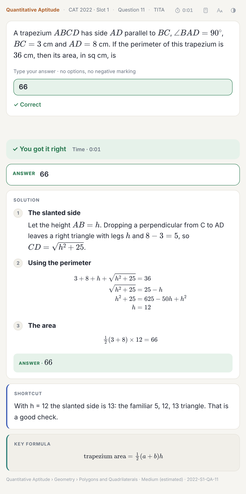
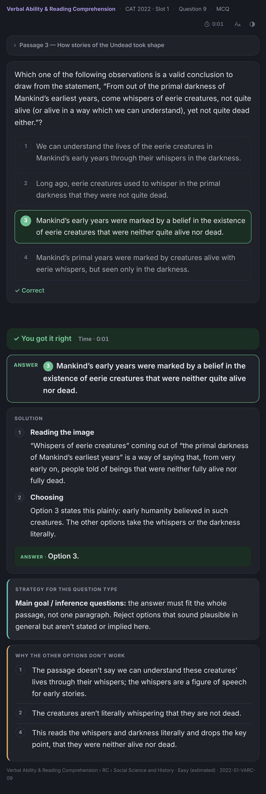
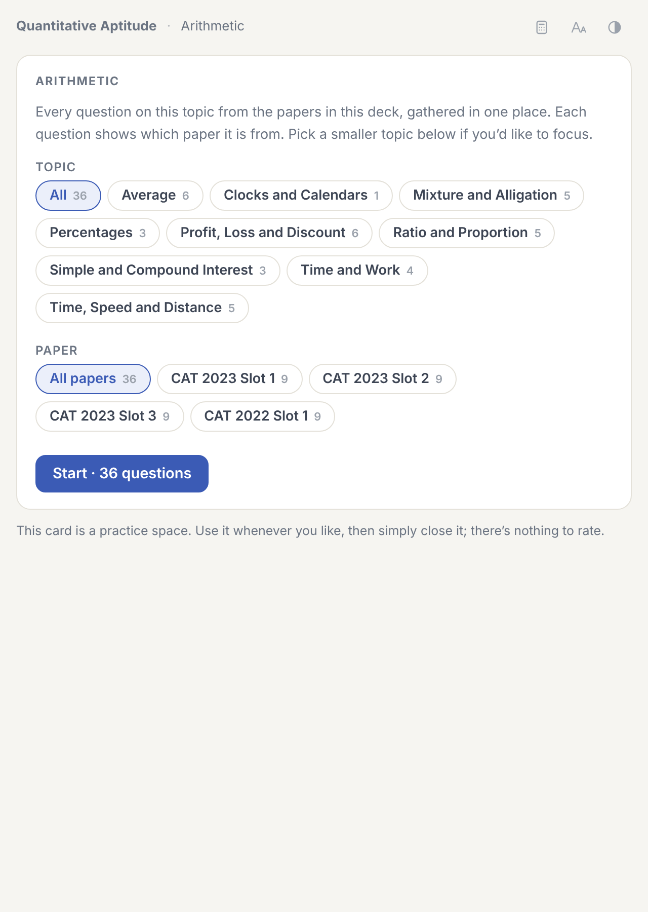
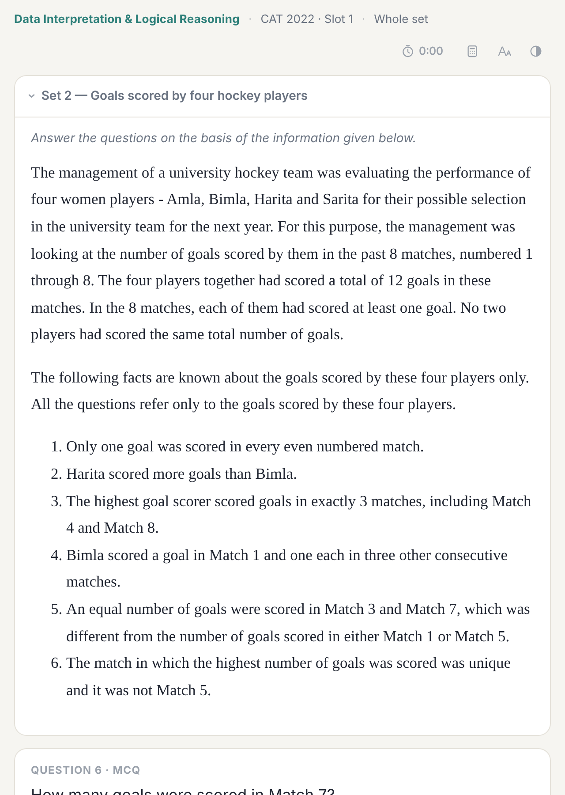

# sipe

An Anki deck of CAT previous-year questions. Each question is an interactive card: pick an option (or type the answer for TITA questions), then flip it for a worked solution.

<p align="center"></p>

## What's in it

| Paper | VARC | DILR | QA | Total |
| --- | ---: | ---: | ---: | ---: |
| CAT 2025 Slot 1 | 24 | 22 | 22 | 68 |
| CAT 2025 Slot 2 | 24 | 22 | 22 | 68 |
| CAT 2025 Slot 3 | 24 | 22 | 22 | 68 |
| CAT 2024 Slot 1 | 24 | 22 | 22 | 68 |
| CAT 2024 Slot 2 | 24 | 22 | 22 | 68 |
| CAT 2024 Slot 3 | 24 | 22 | 22 | 68 |
| CAT 2023 Slot 1 | 24 | 20 | 22 | 66 |
| CAT 2023 Slot 2 | 24 | 20 | 22 | 66 |
| CAT 2023 Slot 3 | 24 | 20 | 22 | 66 |
| CAT 2022 Slot 1 | 24 | 20 | 22 | 66 |
| CAT 2022 Slot 2 | 24 | 20 | 22 | 66 |
| CAT 2022 Slot 3 | 24 | 20 | 22 | 66 |
| CAT 2021 Slot 1 | 24 | 20 | 22 | 66 |
| CAT 2021 Slot 2 | 24 | 20 | 22 | 66 |
| CAT 2021 Slot 3 | 24 | 20 | 22 | 66 |
| CAT 2020 Slot 1 | 26 | 24 | 26 | 76 |
| CAT 2020 Slot 2 | 26 | 24 | 26 | 76 |
| CAT 2020 Slot 3 | 26 | 24 | 26 | 76 |
| CAT 2019 Slot 1 | 20 | 32 | 32 | 84 |
| CAT 2019 Slot 2 | 0 | 24 | 33 | 57 |
| CAT 2018 Slot 1 | 21 | 32 | 33 | 86 |
| | | | | **1457** |

### Simp Mocks

Full-length practice mocks in the CAT pattern, under `06 Papers & Mocks ▸ Simp Mocks`, grouped by series. Each mock has its own deck with the question cards, whole-passage and whole-set cards, and a paper card for practice or a timed attempt. Mock questions are kept out of the past-paper decks and topic practice.

| Mock | VARC | DILR | QA | Total |
| --- | ---: | ---: | ---: | ---: |
| 2025 · Mock 1 | 24 | 22 | 22 | 68 |
| 2025 · Mock 2 | 24 | 22 | 22 | 68 |
| 2025 · Mock 3 | 24 | 20 | 22 | 66 |
| 2025 · Mock 4 | 24 | 22 | 22 | 68 |
| 2025 · Mock 5 | 24 | 20 | 22 | 66 |
| 2025 · Mock 6 | 24 | 22 | 22 | 68 |
| 2025 · Mock 7 | 24 | 22 | 22 | 68 |
| 2025 · Mock 8 | 24 | 22 | 22 | 68 |
| 2025 · Mock 9 | 24 | 22 | 22 | 68 |
| 2025 · Mock 11 | 24 | 22 | 22 | 68 |
| 2023 · Mock 1 | 24 | 10 | 22 | 56 |

Alongside the question cards there are set cards (a whole RC passage or DILR set on one card), formula and technique cards, a practice card for each topic area, and a card for each paper with a practice mode and a timed mock.

## Installing

1. Install Anki: [desktop](docs/install-desktop.md), [Android](docs/install-android.md) or [iPad/iPhone](docs/install-ipad.md).
2. Download `sipe.apkg` from the [latest release](https://github.com/epabafree/sipe/releases/latest).
3. Import it. No add-ons are needed.

If you're upgrading from v0.4 or earlier, read [updating](docs/updating.md) first; the deck layout changed in v0.5.

## Layout

```
sipe
├── 00 Start Here                              guide and Study Planner
├── 01 Verbal Ability & Reading Comprehension  by year and slot, then whole passages
├── 02 Data Interpretation & Logical Reasoning by year and slot, then whole sets
├── 03 Quantitative Aptitude                   by year and slot
├── 04 Practice by Topic
├── 05 Formulas & Concepts
└── 06 Papers & Mocks                          CAT Papers (one card per paper), Simp Mocks
```

Every card is tagged (`sipe::Topic::QA::Algebra::Quadratic_Equations`, `sipe::Paper::2023_S1`, `sipe::Format::TITA` and so on), which is what the Study Planner and the topic cards use.

<p>



</p>

## Notes on the content

Questions, options, passages and data are kept as set in the exam, and answers follow the official keys. Solutions are written for this deck. Charts and maps are drawn as SVG, and data that reads better as a table is given as one.

Questions keep their exam numbers, so a paper can skip a number. The table above shows how many questions each paper has in the deck, and paper cards and timed mocks scale to that.

Difficulty labels are estimates, not official data.

## Documentation

- [Solving a card](docs/using-the-cards.md) · [Toolbar](docs/toolbar-and-tools.md) · [Set cards](docs/set-cards.md)
- [Papers and mocks](docs/papers-practice-and-mock.md) · [Practice by topic](docs/practice-by-topic.md) · [Study Planner](docs/study-planner.md)
- [Formula cards](docs/formula-cards.md) · [Flags](docs/flags.md)
- [Updating](docs/updating.md) · [CSV import](docs/csv-import.md) · [FAQ](docs/faq.md) · [Building from source](docs/building.md)

## Roadmap

- CAT 2018 Slot 2 and CAT 2017
- CAT 1991–2008 (mostly DILR and QA)
- More mocks and longer explanations after that

Found a mistake? Open an issue with the ID printed at the bottom of the answer side, e.g. `2023-S1-QA-07`.
