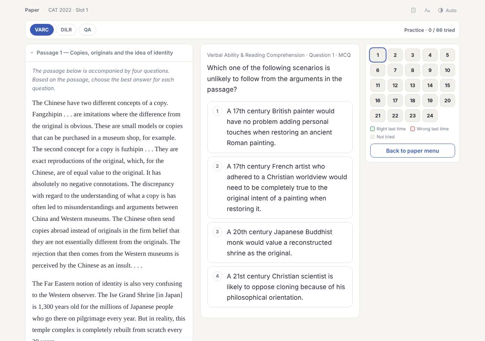
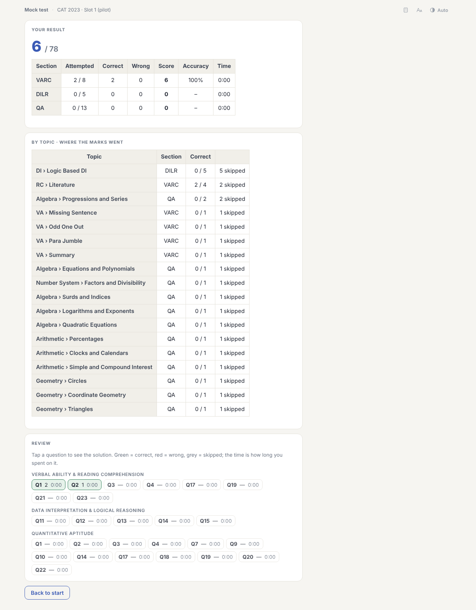

# Papers and mocks

Each paper has its own deck under `06 Papers & Mocks`, holding a single card. The card has two modes.

## Practice

Move between questions with the palette or Previous / Next, answer them in any order and read each solution as you go. Try again resets a question, and "Start this paper afresh" clears everything. The palette remembers what you got right or wrong on that device. Nothing here affects your Anki reviews.

## Timed mock

Choose no timer, the real CAT timing (40 minutes per section, sections locked in order) or a single overall timer. The screen works like the exam: palette, mark for review, clear response. At the end you get a CAT-style score (+3, −1 for a wrong MCQ, no penalty on TITA), a breakdown by section and topic, time per question and every solution. The last 20 attempts per paper are kept on the device.

Paper cards aren't meant to be rated. Open one, use it, and close it, and it stays available. Both sides show the same page.

To redo a paper with the normal question cards instead, use the "Revisit a paper" recipe in the [Study Planner](study-planner.md).
