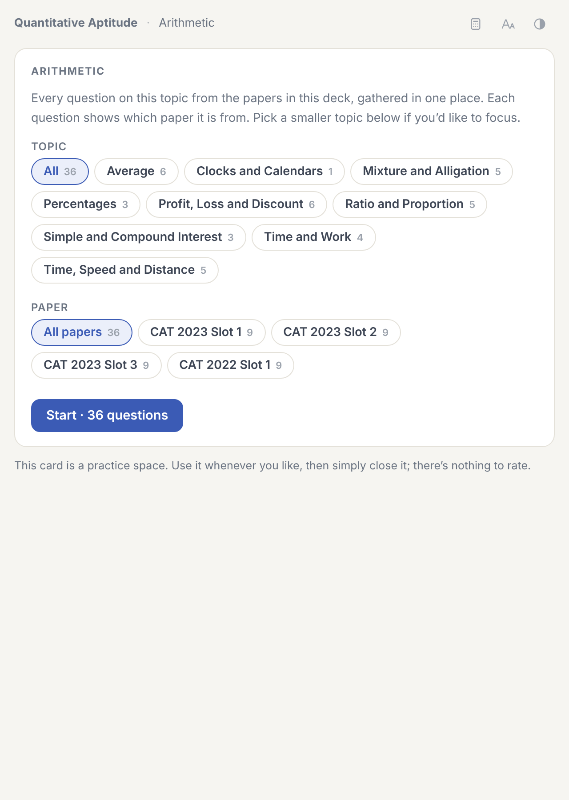

# Practice by topic



`04 Practice by Topic` has one deck per topic area, each holding a single card:

```
04 Practice by Topic
├── Verbal Ability & Reading Comprehension: Reading Comprehension, Verbal Ability
├── Data Interpretation & Logical Reasoning: Data Interpretation, Logical Reasoning
└── Quantitative Aptitude: Algebra, Arithmetic, Geometry, Modern Maths, Number System
```

The card collects every question tagged with that area, from all papers. You can narrow it down by subtopic (e.g. Quadratic Equations, or Inference questions in RC) or by paper. Each question shows which paper it came from, and RC and DILR questions come with their passage or set.

It works like the practice mode on paper cards: palette, instant checking, solutions, Try again, and an option to start the topic afresh. Progress is kept per device and doesn't affect your reviews. Like paper cards, these aren't meant to be rated.
