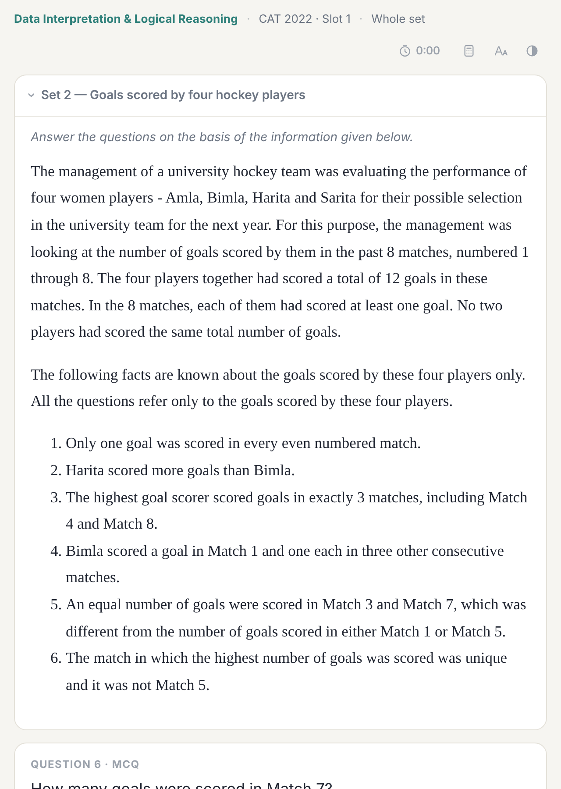

# Set cards

A set card puts a whole RC passage or DILR set on one card with all of its questions, as in the exam. Each question is checked as you answer it, and the answer side shows your score for the set, the answer and explanation for each question, and for DILR the full set solution.

They live at the end of each section: `01 Verbal Ability & Reading Comprehension ▸ Whole passages` and `02 Data Interpretation & Logical Reasoning ▸ Whole sets`. The same questions also exist as single cards in the year decks.
