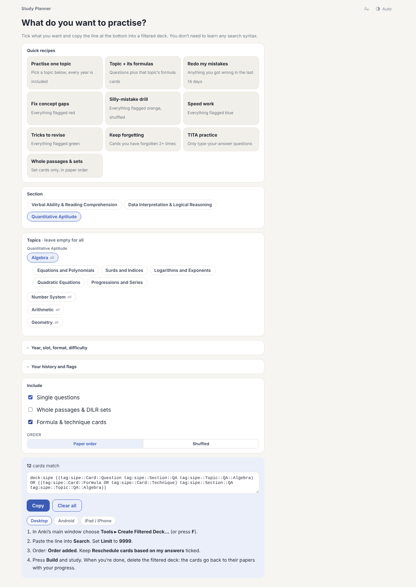

# Study Planner



The Study Planner (in `00 Start Here`) builds an Anki search from the options you tick, which you then use to create a filtered deck. It saves you from writing search syntax by hand.

1. Open the Study Planner card.
2. Pick a recipe, or choose sections, topics, years, slots, format, difficulty, review history and flags.
3. Press Copy.
4. Create a filtered deck and paste the search:
   - Desktop: Tools ▸ Create Filtered Deck (F), paste, set the limit to 9999, Build.
   - AnkiDroid: ⋮ ▸ Create filtered deck.
   - AnkiMobile: Add (+) ▸ Filtered Deck.
5. Delete the filtered deck when you're done. The cards go back to their own decks with their progress intact.

## Recipes

| Recipe | Cards |
| --- | --- |
| Revisit a paper | Every card of one paper, in exam order, without rescheduling |
| Practise one topic | All questions on a topic |
| Topic + its formulas | The same, plus that topic's formula cards |
| Redo my mistakes | Cards you got wrong in the last 7, 14 or 30 days |
| Fix concept gaps / Silly-mistake drill / Speed work / Tricks to revise | Red, orange, blue or green flags |
| Keep forgetting | Cards forgotten two or more times |
| TITA practice | Typed-answer questions only |
| Whole passages & sets | Set cards only |

## Example searches

```
deck:sipe tag:sipe::Card::Question tag:sipe::Topic::QA::Algebra
deck:sipe tag:sipe::Card::Question tag:sipe::Section::DILR rated:14:1
deck:sipe tag:sipe::Section::QA (flag:1 OR flag:2)
```

The count on the card covers topics and filters only. History and flags are applied by Anki when the deck is built.
