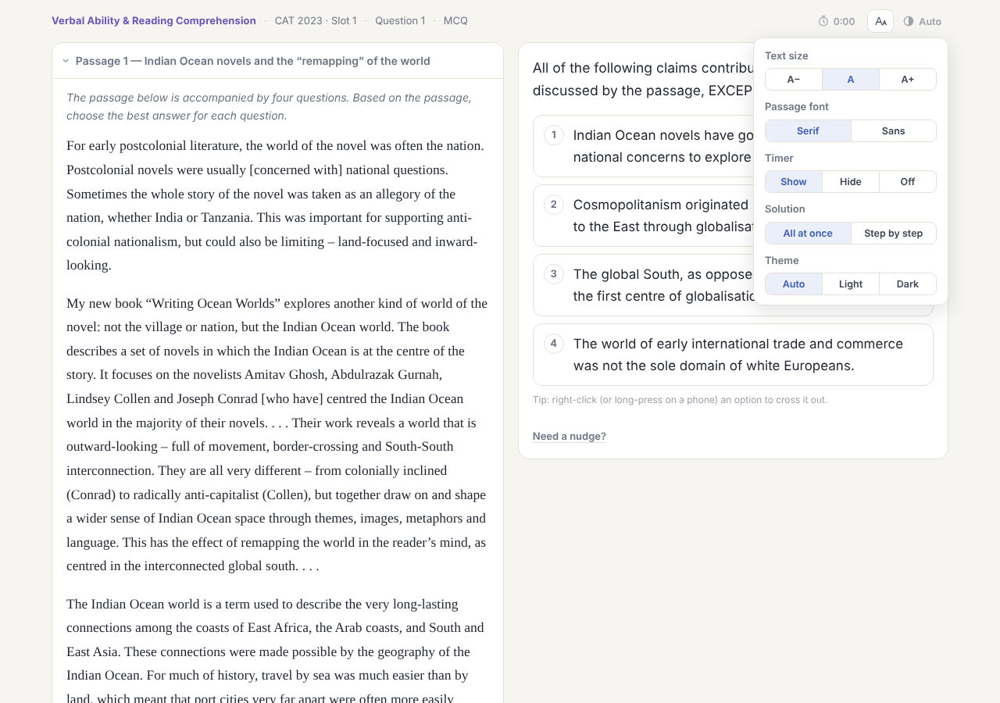

# Toolbar and tools

The small icon row at the top right of every card:

| Icon | What it does |
| --- | --- |
| ⏱ **Timer** | Starts when the question appears and stops when you answer. The answer side shows “Time · 1:42”. Tap to hide it (it still records); turn it fully off in **Aa**. There are no targets and no countdown. |
| ▦ **Calculator** | A basic calculator like the CAT on-screen one (QA and DILR cards). |
| **Aa** | Text size (A− / A / A+), passage font (Serif / Sans), timer (Show / Hide / Off), solution display (All at once / Step by step), theme. |
| ◐ **Theme** | Auto (follow Anki) → Light → Dark, without leaving the card. |

Choices are remembered on each device.

**Handy extras**
- **Cross out an option**: right-click it (desktop) or long-press it (phone). Do the same again to undo.
- **Highlight**: select words in a passage or DILR set, then tap the **Highlight** button that appears. Tap a highlight to remove it.
- **Need a nudge?**: under the options; shows only the first step, without the answer.
- **Step by step**: with this on, solutions open one step at a time with a **Next step** button.

Keyboard: **1–4** picks an option on desktop; **← / →** move between questions in a paper.
