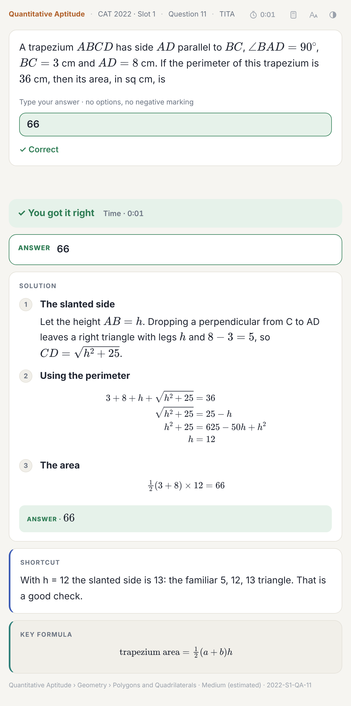

# Solving a card

The header shows the section, paper, question number and whether it's MCQ or TITA.

For an MCQ, tap an option or press 1–4. The card shows right or wrong straight away and locks. For a TITA question, type the answer and press Enter. Numbers are compared by value, so `20808`, `20,808` and `₹20808` are all accepted.

On a wide screen the passage or DILR set sits next to the question; on a phone it collapses above it.

The answer side has, in order:

1. Whether you were right, and your time if the timer is on
2. The correct answer
3. The solution, as numbered steps. VARC solutions quote the passage, with ¶ marking the paragraph.
4. For DILR, the full solution to the set
5. A shortcut, where there is one
6. The key formula (QA), key idea (DILR) or the approach for that question type (VARC)
7. Why each wrong option is wrong

Rate the card as you normally would. To go back over questions you've already done, use a [paper card](papers-practice-and-mock.md) or [topic practice](practice-by-topic.md).
